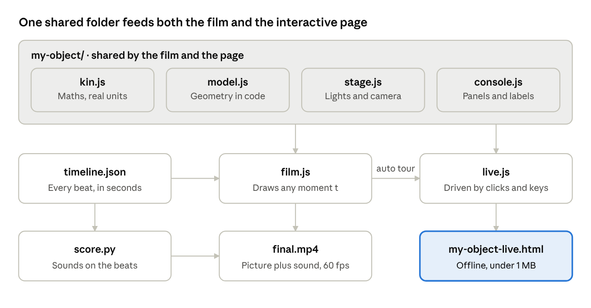

# Teardown: Build a 3D Object People Can Take Apart

Nov 3, 2026 · Eole

## What you'll make

[Teardown](https://github.com/elvarofficial/teardown) turns a machine or object into two things from one codebase:

- **An interactive page:** one offline HTML file, usually under 1 MB. The object runs in the middle, with panels of live readouts around it and a button for each part. Click a button and the camera moves in while that part opens up. Left alone, the page tours itself with a cursor, and any click hands control to the visitor.
- **A film:** the same tour recorded frame by frame to a 1920×1080, 60 fps MP4, with a soundtrack generated on the same timeline.

It suits anything with parts that move or come apart: engines, gearboxes, landing gear, pumps, clocks, cameras, robots, walking linkages. Everything is built from code, using three.js for the 3D, with no modelling software and no hand-made keyframes.

This guide is the workflow that worked for me, from a reference image to a published page and video. It applies to any object.

## Install and look at the examples

You need Node.js 20 or newer. For video you also need ffmpeg, and for sound Python 3 (standard library only). It runs on Mac and Linux; on Windows, use WSL.

Install it as a Claude Code skill:

```
npx skills add elvarofficial/teardown -g -a claude-code
```

Or clone it to where Claude Code looks for skills:

```
git clone https://github.com/elvarofficial/teardown ~/.claude/skills/teardown
```

Then run this once in the installed folder. The last command downloads the browser used to record frames.

```
cd ~/.claude/skills/teardown && npm install && npx playwright install chromium
```

Before building anything, build the three examples and click through them. Each one shows a different way to drive a machine.

```
node sims/build.mjs v8-live            # → teardown-out/dist/v8-live.html
node sims/build.mjs cessna-live
node sims/build.mjs strandbeest-live
```

| Example | Driven by | Worth copying |
| --- | --- | --- |
| V8 engine | Crank angle | Cutaway modes, a cylinder picker, charts synced to the motion |
| Cessna 337 landing gear | One stroke value from 0 to 1 | One number posing a whole mechanism |
| Strandbeest walking linkage | Wind speed | An exact linkage solver; many repeated parts drawn cheaply |

When you start your own object, copy the example closest to it.

## How a project is laid out

A teardown project is a few small files, each with one job. The film and the interactive page share all of them, so a fix in one place shows up in both.



The core rule: every frame is a pure function of one input. The film asks for the moment at 12.5 seconds and always gets the same picture. That lets a slow computer record frame by frame without dropping anything, and keeps picture and sound in sync. The interactive page feeds the same functions from clicks instead of the clock.

## The workflow, step by step

Work in this order. Each step gives the next one something solid to build on.

1. **Collect references.** Find photos, cutaway drawings, exploded diagrams or a video of the real object. Write down real dimensions: lengths, tooth counts, link lengths, speeds. An object built from a sentence alone comes out generic; one built against a reference comes out convincing.
2. **Set up the folders.** Make a project folder with one shared folder for the object's code and one small entry folder per output (a `main.js` each):
   - `my-object/` holds the shared code.
   - `my-object-film/` holds the film entry plus `timeline.json`.
   - `my-object-live/` holds the interactive page entry.
   - Optionally, `my-object-preview/` shows just the model, for checking angles quickly.
3. **Write the maths first** (`kin.js`). Use real units and one input that drives everything: time, a crank angle, a stroke from 0 to 1. Every pose and every number on the panels is a function of that input, so the display can never disagree with the motion. Keep three.js out of this file.
4. **Build the geometry** (`model.js`). Make shapes from code: lathed profiles, tubes, boxes, instanced copies. Group the object into subsystems, the parts a visitor will open, and give each part a direction and delay for coming apart. An `update(state)` function poses everything.
5. **Set the stage and panels** (`stage.js`, `console.js`). Use a pale studio background and one accent colour that marks whatever is changing. Panels sit in a fixed 1600×900 layout and read the same functions as the model.
6. **Script the film** (`film.js` and `timeline.json`). List every beat in seconds: when each subsystem opens and closes, camera moves and labels. `render(t)` draws any moment from scratch.
7. **Build the interactive page** (`live.js`). Reuse the film's model, stage and panels, and wire the buttons to the same actions the script performs. With no input, play the film as an auto tour. Any click takes over, and quiet for about 25 seconds hands control back.
8. **Review, render, publish.** The next sections cover these steps.

Build a page at any point with `node ~/.claude/skills/teardown/sims/build.mjs ./my-object-live`. It takes under a second, so rebuild after every change.

## Review frame by frame

Don't wait for the full video to find problems. Render contact sheets of stills, which take seconds to minutes, and fix what they show.

```
SKILL=~/.claude/skills/teardown
node $SKILL/sims/build.mjs ./my-object-film
# one tile per beat in timeline.json
node $SKILL/sims/capture.mjs my-object-film --size 1600x900 --dpr 1.2 --stills beats --timeline my-object-film/timeline.json --cols 5 --out teardown-out/beats.png
# one full frame at 12.5 s
node $SKILL/sims/capture.mjs my-object-film --size 1600x900 --dpr 1.2 --still 12.5 --out teardown-out/f12.png
# a transition, every 0.2 s
node $SKILL/sims/capture.mjs my-object-film --size 1600x900 --dpr 1.2 --stills every:0.2 --from 8 --to 10 --out teardown-out/move.png
```

`--size` is the layout size and `--dpr` multiplies it: 1600×900 at 1.2 gives 1920×1080.

Check each sheet against this list, fix, rebuild and repeat until a full pass finds nothing:

- **The mechanism:** parts that should touch, touch, and nothing passes through anything. When parts collide, fix it with a number in the model; never hide it with the camera.
- **Composition:** one focal point per frame, the object filling 60–70% of the view, and nothing important near an edge.
- **Labels:** none clipped, none covering the part they name, all readable at phone size.
- **Lighting:** near-white parts not blown out, and bloom not eating detail.
- **Timing:** each state holds long enough to read, about 1 second for a short phrase.

## Render the video and add sound

**Picture.** One command records the whole film:

```
node $SKILL/sims/capture.mjs my-object-film --size 1600x900 --dpr 1.2 --fps 60 --out teardown-out/silent.mp4
```

With a graphics card this takes minutes. Without one, it can take hours: a detailed object rendered at 4–5 seconds per frame on 4 CPU cores, about 2.5 hours for a 30-second film. On a slow machine, render in 2-second chunks instead (`--from 0 --to 2`, `--from 2 --to 4`, and so on), skip chunks that already exist, and join them with ffmpeg's concat at the end. A crash then costs one chunk, not the whole render.

**Sound.** Write a `score.py` that reads the same `timeline.json` and places sounds on its beats. The toolkit synthesises everything in Python, adds CC0 samples, and masters to −14 LUFS automatically.

```
python3 $SKILL/run_sfx.py --list                                   # the available sound generators
python3 $SKILL/run_sfx.py my-object/score.py --out teardown-out/score.wav
```

Keep sound to accents, such as a click per button press or a whoosh under a camera move. Leave continuous motion silent.

**Combine them:**

```
ffmpeg -y -i teardown-out/silent.mp4 -i teardown-out/score.wav -map 0:v -map 1:a -c:v copy -c:a aac -b:a 256k -shortest -movflags +faststart teardown-out/final.mp4
```

**Check the result** before posting: the frame count equals duration × 60, audio and video lengths match, it decodes cleanly, and loudness is about −14 LUFS:

```
ffprobe -v error -count_frames -show_entries stream=codec_type,nb_read_frames,duration -of compact teardown-out/final.mp4
ffmpeg -nostats -i teardown-out/final.mp4 -af ebur128=peak=true -f null - 2>&1 | grep -E "I:|Peak:"
```

## Lessons from real use

These are the things I'd tell myself before starting.

**Detail**

- **Build a parts kit early.** Write small functions for the components that recur: screws, bearings, gears, circuit boards, springs, complete motors. Then every subsystem gets convincing internals in a few lines, and the close-ups match the detail of the full exploded view.
- **Design the internals yourself.** A reference sheet shows the outside well, but its inner components are often simplified. Invent the insides of each subsystem the way an engineer would: a motor has a stator, rotor, bearings, gears and a driver board.
- **Open each subsystem as a stack.** Parts sliding apart in order along one axis read clearly. Parts scattering randomly do not.

**Speed**

- **Hide what can't be seen.** Draw a subsystem's internal parts only while it's open, and skip shadows on small parts. Together with low-poly small parts, this cut my render time by about 10% with no visible change.
- **Use low-poly versions of tiny parts.** A 2 mm screw doesn't need 64 segments.

**Reliability**

- **Keep `render(t)` pure.** No `Math.random()`, no clock and no state between frames. Recording jumps to arbitrary times, so any hidden state shows up as flicker or drift.
- **On a low-memory machine, run one render at a time** and retry failed chunks automatically. A single slow frame can hit the recorder's 30-second screenshot timeout.
- **Run long renders as a background service** (on Linux, `systemd-run --user`), so they survive a closed terminal or a restarted session.

**Interactivity**

- **A recorded film is not an interactive page.** The film build plays a script, and its cursor is animated. Build the live page separately so that its buttons really respond.
- **Share code between film and page.** Make the pose a function of explicit values (gait phase, how open each part is) rather than of the film's clock. The page can then drive the same model from clicks.
- **Test the page automatically.** A short Playwright script that clicks each button, drags to orbit and checks for console errors catches broken controls before your followers do.
- **Keep the page under 1 MB** so social sites can read its preview card.

## Using it through Claude Code

Teardown is written as a Claude Code skill, so you can describe what you want in plain words and Claude builds it, following the toolkit's rules. Prompts from the toolkit's README:

> Build me a simulator of a 4-stroke motorcycle engine I can take apart.

> How does a mechanical watch keep time? Show me as a simulator.

> Make a teardown of a hydraulic excavator arm and record a 20-second video of it.

**What made the biggest difference when steering it:**

- **Attach a reference image** and say what it's for: the outer look, the panel layout, or the list of parts.
- **Give the structure of the film:** its length, the order of close-ups, and how it ends. For example: "25–30 s: full view, then close-ups of A, B and C, then a full exploded view and an exit."
- **Ask for the interactive page explicitly** if you want one. Say "an interactive page I can click", not just "an HTML file".
- **Give feedback on frames, not feelings.** "The close-up internals are too simple compared to the final exploded view" gets a precise fix.
- **State your machine's limits:** RAM, CPU, no GPU. Ask for chunked, resumable renders so a crash doesn't lose hours.
- **Ask for checks:** frame count, loudness, and a click-through test of the page.

## Troubleshooting

| Problem | Fix |
| --- | --- |
| "Browser not found" or Playwright errors | Run `npx playwright install chromium` in the toolkit folder, or set `CHROMIUM=/path/to/chrome` |
| Capture reports a software renderer | No GPU was found. It still works, only slower; the GPU flags live in `paths.mjs`. |
| A frame times out during capture | The machine is overloaded. Run one render at a time, close other apps, and retry that chunk. |
| The whole frame turns black | One bad pixel spreads through bloom. Clamp every `pow()` base in your shaders. |
| A shadow or decal on the floor flickers or vanishes | Give its material `polygonOffset` |
| Something looks right in a still but wrong in the video | Hidden state in `render(t)`: a random number, the clock, or a value carried between frames |
| The page is choppy on a laptop | Add quality tiers that drop pixel ratio, ambient occlusion and shadow size when frames run long, as the examples do |
| GitHub shows the HTML as code | GitHub doesn't run pages. Download the file and open it, or host it on GitHub Pages. |

## Credits and links

- **Toolkit:** [elvarofficial/teardown](https://github.com/elvarofficial/teardown), MIT licence
- **Built on:** [whaleyxbt/claude-motion](https://github.com/whaleyxbt/claude-motion), MIT, which supplies the runtime, frame capture, sound engine and review rules
- **Samples:** CC0 sounds from Freesound, prepared by [Barty-Bart/motion-graphics](https://github.com/Barty-Bart/motion-graphics)
- **Tools:** [three.js](https://threejs.org), [Playwright](https://playwright.dev), [ffmpeg](https://ffmpeg.org), [Claude Code](https://claude.com/claude-code)

If you build something with it, tag me. I'd love to see what you take apart.
